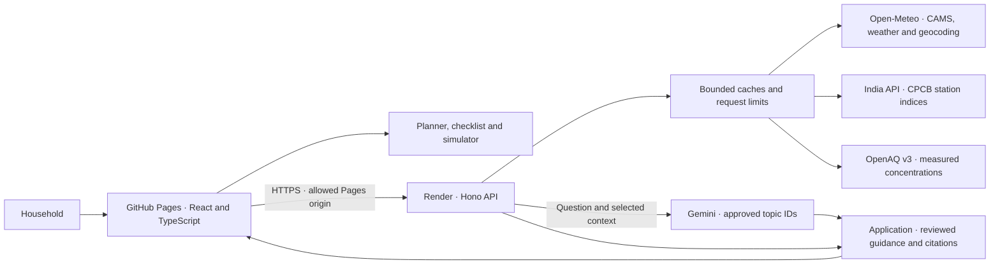

# SaansAI — Urban Air Quality Assistant

SaansAI helps Indian households decide what to do on polluted days. Start with [today’s action plan](https://jatinkumar11954.github.io/AQI/), select a city and try a sample household. No account or API key is required to use the public application.

- **Today and Daily planner** combine modeled US AQI and weather with separately labeled station reports. Set work hours, commute, family needs, activity and budget to get cautious time windows and a daily checklist.
- **Indoor air** explains source control, ventilation, filtration and low-emission routines across three budget tiers.
- **Impact simulator** compares petrol use, fuel and fare spending, hypothetical household participation and outdoor PM2.5 concentration-time using documented formulas.
- **Ask SaansAI** uses Gemini to choose up to two reviewed guidance topics from a question and current context. The application calculates numbers, applies safety rules and renders cited answers. Rules mode remains available when Gemini is unavailable.

## Architecture



The server validates requests with Zod, caps JSON bodies at 4 KiB, and sets a restrictive content policy. Upstream responses are size-limited and requests use bounded timeouts. API keys stay in the Render secret store or the ignored local environment file. Household settings and the checklist are stored in the browser. Read [the API contract](docs/api.md) and [data and privacy methodology](docs/methodology.md).

## Getting Started

### Prerequisites
- Node.js `>=22.14`

### Local Development
1. Copy the environment template if you want to enable optional OpenAQ or Gemini API integrations:
   ```bash
   cp .env.example .env
   ```
2. Install dependencies and start the development server:
   ```bash
   npm ci
   npm run dev
   ```
   Open `http://127.0.0.1:4173`. Without keys, the app uses Open-Meteo and the CPCB station relay. The assistant labels its deterministic rules responses.

### Environment Variables
See [.env.example](.env.example):
- `PORT` (default `4173`)
- `OPENAQ_API_KEY` (optional, server-only)
- `GEMINI_API_KEY` (optional, server-only)
- `GEMINI_MODEL` (optional, defaults to [`gemini-3.5-flash-lite`](https://aistudio.google.com/docs/models/gemini-3.5-flash-lite))
- `GEMINI_DAILY_LIMIT` (optional, defaults to 100 attempted classifications per process in a 24-hour window)
- `SAANS_PUBLIC_ORIGIN` (optional, exact HTTPS GitHub Pages origin for cross-origin API access)

## Verification

```bash
npm run check      # TypeScript strict typecheck
npm run build      # Vite client + Node server (dist/server.mjs) + Worker bundle (dist/worker.mjs)
npm run test:coverage # Unit and API tests with a 90% critical statements and lines gate
npx playwright install chromium
npm run test:e2e   # Desktop/mobile Chromium journeys and axe WCAG 2.2 A/AA checks
node scripts/smoke.mjs  # Live-provider smoke against a running local production build
```

## Deployment

The production frontend is on [GitHub Pages](https://jatinkumar11954.github.io/AQI/) and the live API is on [Render](https://aqi-0xk3.onrender.com/api/ready).

1. On GitHub, set Pages publishing to **GitHub Actions**. The [workflow](.github/workflows/pages.yml) verifies each push to `main` and publishes `dist/pages` with relative asset paths.
2. Set the GitHub Actions repository variable `SAANS_API_BASE_URL` to the Render HTTPS origin. This is a public build setting.
3. On Render, use `npm ci && npm run build` as the build command and `npm start` as the start command. Set `SAANS_PUBLIC_ORIGIN` to the exact Pages origin, for example `https://jatinkumar11954.github.io`, without a repository path. Set optional API keys in Render’s environment settings. Use `/api/ready` as the health check path.
4. Run `node scripts/smoke.mjs https://aqi-0xk3.onrender.com` after the release. Run the public UI separately to verify the Pages-to-Render request path.

A Pages build without an API origin fetches public feeds directly and uses Rules mode. Free Render instances may need about a minute to wake after being idle. Docker and Cloudflare Worker build targets are also included. [Render free instance limits](https://render.com/docs/free)

### Vercel Same-Origin Alternative (Recommended for Lower Cold-Start Latency)

[vercel.json](vercel.json) and [api/index.ts](api/index.ts) deploy the Vite client (`dist/client`) and Hono API (`/api/*`) on the same HTTPS origin in Vercel’s Mumbai (`bom1`) region under the free Hobby plan (no credit card required, Fluid Compute + Node.js bytecode caching).

1. Import the repository in Vercel (or run `vercel link`) and set server-only environment variables (`OPENAQ_API_KEY`, `GEMINI_API_KEY`, `GEMINI_MODEL`, `GEMINI_DAILY_LIMIT`) in Vercel Project Settings. Do not expose keys with `VITE_*`.
2. Vercel builds with `vite build` (`dist/client`) and routes `/api/(.*)` to `api/index.ts`, using `x-vercel-forwarded-for` for per-client rate limiting.
3. For automated CI-gated GitHub Actions deploys, set repository variable `SAANS_VERCEL_DEPLOY=true` and secrets `VERCEL_TOKEN`, `VERCEL_ORG_ID`, `VERCEL_PROJECT_ID` for [the Vercel workflow](.github/workflows/vercel.yml). Roll back immediately via Vercel Dashboard (**Instant Rollback**) or `vercel rollback`.
4. Retain the Render service until `node scripts/smoke.mjs <vercel-url>` and browser journeys pass on the Vercel deployment.

## Documentation & PromptWars Artifacts

- [Requirements & Verification Matrix](docs/requirements.md)
- [Development Journal](docs/journal.md)
- [AI Tooling & Prompt Evolution](docs/ai-tooling-and-prompts.md)
- [Antigravity Session Artifacts](docs/artifacts/)

- [Data methodology and limitations](docs/methodology.md)
- [Evidence-based evaluation report](docs/evaluation.md)
- [Screen-recording plan](docs/demo.md)
- [LinkedIn draft](docs/linkedin-draft.md)
