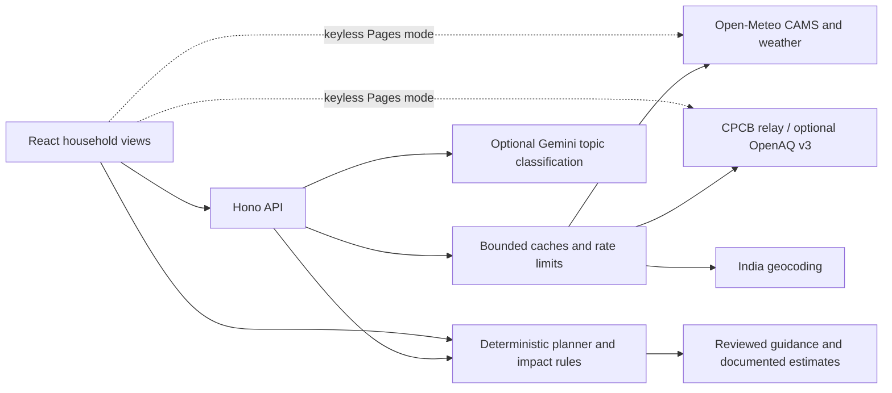

# SaansAI — Urban Air Quality Assistant

SaansAI helps Indian households plan daily outdoor activities, commutes, indoor air hygiene, and routine shifts around hourly air quality forecasts and nearby monitoring station reports.

## Key Capabilities

- **Hourly Regional Forecast (`Today`)**: Displays modeled US AQI, PM2.5, PM10, weather context (Open-Meteo CAMS & Weather), and separate observed station data (OpenAQ v3 and/or CPCB station relay) with explicit timestamps and staleness checks—never conflating single station snapshots with an official India National AQI.
- **Household Daily Planner (`Daily planner`)**: Filters 24-hour forecasts by sensitive groups (children, older adults, respiratory sensitivity), work shifts (including overnight blocks), commute mode, and activity type to surface conservative, forecast-gated time windows alongside a persistent daily checklist.
- **Indoor & Low-Emission Guidance (`Indoor air`)**: Source-linked EPA and AirNow recommendations across zero-cost, low-budget, and HEPA filtration tiers, plus ventilation gating against outdoor pollution and ambient temperature (`18–32 °C`).
- **Routine & Exposure Simulator (`Impact simulator`)**: Deterministic calculator comparing petrol use, fuel/fare savings, tailpipe CO₂ proxy (`2.34 kg CO₂/L`), hypothetical community scaling, and hourly outdoor PM2.5 exposure proxy (`µg·h/m³`).
- **Source-Grounded Assistant (`Ask SaansAI`)**: Uses Gemini Developer API strictly as a structured JSON topic classifier (`temperature: 0`, strict `TOPICS` enum schema) with automatic fallback to deterministic local rules when unconfigured, quota-limited, or unavailable. All advice wording, numbers, and source links are selected deterministically from the app’s reviewed catalog.

## Architecture



### Security and privacy

- **Frontend**: React 19, TypeScript, Tailwind CSS v4, Lucide icons, and self-hosted Fontsource fonts (`Manrope`, `DM Sans`).
- **Server / Edge API**: Hono (`src/server/app.ts`) running on either Node (`src/server/index.ts`) or Cloudflare Workers (`src/server/worker.ts`).
- **Safety & Hardening**:
  - Strict `zod` validation for coordinates (`6–38°N, 67–98°E`), search strings, household profiles, and assistant requests.
  - Same-origin checks, `4096`-byte body limits, per-IP rate limiting, upstream caching with bounded stale fallback, and `no-store` headers on API responses.
  - Strict Content-Security-Policy (`default-src 'self'`), `X-Content-Type-Options: nosniff`, `X-Frame-Options: DENY`, and `Referrer-Policy: no-referrer`.
  - API keys (`OPENAQ_API_KEY`, `GEMINI_API_KEY`) stay strictly server-side and are never committed or exposed to client bundles.

## Getting Started

### Prerequisites
- Node.js `>=22.14`

### Local Development
1. Copy the environment template if you want to enable optional OpenAQ or Gemini API integrations:
   ```bash
   cp .env.example .env
   ```
2. Install dependencies and start the development server:
   ```bash
   npm ci
   npm run dev
   ```
   Open `http://127.0.0.1:4173`. Without keys, the app uses Open-Meteo and the CPCB station relay. The assistant labels its deterministic rules responses.

### Environment Variables
See [.env.example](.env.example):
- `PORT` (default `4173`)
- `OPENAQ_API_KEY` (optional, server-only)
- `GEMINI_API_KEY` (optional, server-only)
- `GEMINI_MODEL` (optional, defaults to `gemini-3.5-flash-lite`)
- `SAANS_PUBLIC_ORIGIN` (optional, exact HTTPS GitHub Pages origin for cross-origin API access)

## Verification

```bash
npm run check      # TypeScript strict typecheck
npm run build      # Vite client + Node server (dist/server.mjs) + Worker bundle (dist/worker.mjs)
npm test           # Vitest unit & API contract tests
npx playwright install chromium
npm run test:e2e   # Desktop/mobile Chromium journeys and axe WCAG 2.1 A/AA checks
node scripts/smoke.mjs  # Live-provider smoke against a running local production build
```

## Deployment

- **GitHub Pages**. The [workflow](.github/workflows/pages.yml) verifies and deploys `dist/pages` on pushes to `main`. Select **GitHub Actions** as the Pages publishing source. `npm run build:pages` produces the keyless site with relative asset links. It fetches the public forecast, weather, and CPCB relay directly and uses local rules for Q&A.
- **Optional Pages API**. Host the Node or Worker backend separately over HTTPS. Set `SAANS_PUBLIC_ORIGIN` on that backend to the Pages origin such as `https://username.github.io`. Set the GitHub repository Actions variable `SAANS_API_BASE_URL` to the backend's HTTPS origin and rerun the workflow. Put API keys only in that backend's secret store. GitHub Pages serves static assets. [GitHub Pages documentation](https://docs.github.com/en/pages/getting-started-with-github-pages/creating-a-github-pages-site)
- **GitHub Pages (Static SPA + Direct Public Feeds)**:
  Automated via [.github/workflows/pages.yml](.github/workflows/pages.yml) on push to `main`:
  ```bash
  npm run build:pages
  ```
  Outputs to `dist/pages` (`vite build --mode pages`), fetching public Open-Meteo and CPCB relay feeds directly in the browser with client-side deterministic rules in `Ask SaansAI` (or via an optional HTTPS backend set in `SAANS_API_BASE_URL`).
- **Node.js Production**:
  ```bash
  npm run build
  npm start
  ```
- **Docker**:
  ```bash
  docker build -t saansai .
  docker run -p 4173:4173 --env-file .env saansai
  ```
- **Cloudflare Workers**:
  Configured via [wrangler.toml](wrangler.toml) using `npm run build` (`dist/worker.mjs` with embedded static assets).

## Documentation & PromptWars Artifacts

- [Requirements & Verification Matrix](docs/requirements.md)
- [Development Journal](docs/journal.md)
- [AI Tooling & Prompt Evolution](docs/ai-tooling-and-prompts.md)
- [Antigravity Session Artifacts](docs/artifacts/)

- [Data methodology and limitations](docs/methodology.md)
- [Evidence-based evaluation report](docs/evaluation.md)
- [Screen-recording plan](docs/demo.md)
- [LinkedIn draft](docs/linkedin-draft.md)
