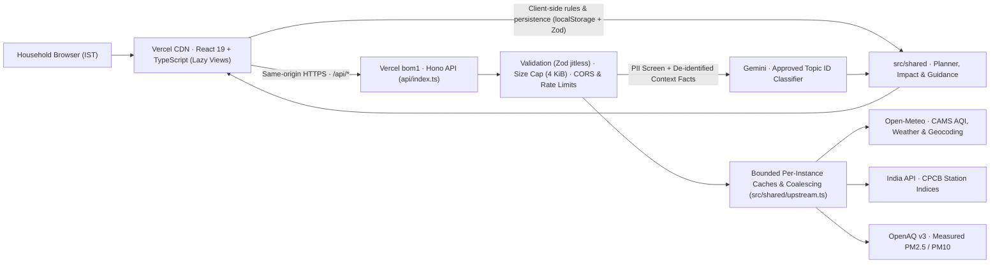

# SaansAI — Urban Air Quality Assistant

**SaansAI** helps Indian households decide what to do when outdoor air pollution rises. Start immediately on the live app at **[aqi-tau.vercel.app](https://aqi-tau.vercel.app/)**, choose an Indian city or neighbourhood, or load a sample household profile. No user account or client-side API key is required. [Public GitHub repository](https://github.com/jatinkumar11954/AQI)

Built for **PromptWars Virtual Challenge 06 (Urban Air Quality Assistant)**, SaansAI pairs real-time regional modeling and nearby ground-station observations with household-specific schedules, source-separated risk screens, explainable impact projections, and a strictly grounded Gemini assistant.

---

## Table of Contents

- [Core Capabilities](#core-capabilities)
- [Architecture](#architecture)
- [Project Layout](#project-layout)
- [Data Sources & Safety Rules](#data-sources--safety-rules)
- [API Endpoints](#api-endpoints)
- [Security & Privacy Model](#security--privacy-model)
- [Local Development & Configuration](#local-development--configuration)
- [Verification, Testing & Code Quality](#verification-testing--code-quality)
- [Deployment](#deployment)
- [Documentation & Limitations](#documentation--limitations)

---

## Core Capabilities

| View | Purpose | Key Behaviour & Safeguards |
| --- | --- | --- |
| **Today** (`#today`) | Immediate action overview, modeled AQI, station telemetry, outlook, and weather | Leads with household priority actions, current Open-Meteo **CAMS US AQI / PM2.5 / PM10**, a separate ground-station card (**OpenAQ v3** concentrations and/or **CPCB relay** India-scale sub-indices), weather conditions, and a **24h / 48h interactive chart & accessible forecast table**. |
| **Daily planner** (`#planner`) | Household-specific scheduling and daily checklist | Supports preset households (`School-day household`, `Senior at home`, `Outdoor worker`), sensitive-group flags (`Children`, `Older adults`, `Sensitive to air pollution`), work hours (including overnight shifts), commute mode, activity type, and persistent browser-saved checklists. |
| **Indoor air** (`#indoor`) | Practical indoor source control, ventilation, and filtration | Screens window opening against current model AQI, nearby station caution, and comfort temperature (`18–32 °C`); organizes guidance into **Zero cost**, **Low budget**, and **Premium** tiers plus **Low-emission routines**. |
| **Impact simulator** (`#impact`) | Compare travel fuel/CO₂ changes and hourly outdoor PM2.5 proxy | Calculates monthly petrol litres, signed tailpipe CO₂ delta (`2.34 kg CO₂/L` UK DESNZ DUKES 2026 proxy), net fuel-and-fare savings (`₹`), multi-household community scale-up, and an hourly outdoor PM2.5 concentration-time proxy (`µg·h/m³`, capped at `60` minutes). |
| **Ask SaansAI** (`#assistant`) | Natural-language guidance in English and Hindi quick-tip mode | Routes user questions through **Gemini** constrained to `temperature: 0` JSON classification (`1–2` approved `TOPICS`), renders reviewed catalog guidance and citations, blocks common contact details before reaching Gemini, and degrades gracefully to deterministic **Rules mode** when offline, rate-limited, or unconfigured. |

---

## Architecture

SaansAI runs as a same-origin React + TypeScript frontend backed by a strict Hono API on Vercel Serverless (`bom1` Mumbai region). Secondary routes lazy-load independently, domain rules run identically on client and server via `src/shared/`, and optional external providers remain isolated on the server.



### Design Highlights

- **Isolated location state**: `src/client/use-air-readings.ts` binds fetched telemetry to coordinates, aborts stale fetches on rapid city switches, triggers a single retry on transient `502`/`503`/`504` errors, surfaces cold-start slow notices after `2.8s`, and marks prior readings stale rather than wiping the screen during temporary outages.
- **Strict scale separation**: Modeled US AQI (CAMS) is never blended with OpenAQ particulate mass measurements (`µg/m³`) or CPCB India-scale station sub-indices. Each feed has its own status (`fresh`, `stale`, `no-station`, `unavailable`, `unconfigured`), timestamp, and attribution link.
- **CSP-safe runtime validation**: Zod runs with `z.config({ jitless: true })` so client validation succeeds cleanly under `script-src 'self'` without dynamic code evaluation.

---

## Project Layout

```text
.
├── api/
│   └── index.ts                 # Vercel Serverless entry forwarding x-vercel-forwarded-for & env keys to Hono
├── docs/                        # Requirements matrix, API contract, methodology, evaluation, journal & prompts
├── scripts/
│   ├── build-worker.mjs         # Generates embedded Cloudflare Worker static asset map
│   └── smoke.mjs                # Live 6-city end-to-end HTTP smoke test against a running deployment
├── src/
│   ├── client/
│   │   ├── main.tsx             # Shell navigation, persistence wiring, accessibility landmarks & lazy view loader
│   │   ├── overview.tsx         # Today view: AirOverview, Hero, CleanerWindow, WeatherCard
│   │   ├── forecast-card.tsx    # Interactive 24h/48h CAMS chart, metric selector & accessible data table
│   │   ├── station-panel.tsx    # Observed OpenAQ & CPCB-relay station reporting card
│   │   ├── planner-view.tsx     # Household profile form, sample household switcher & checklist
│   │   ├── indoor-view.tsx      # Ventilation screen, tiered indoor actions & low-emission routines
│   │   ├── impact-view.tsx      # Petrol CO₂/savings calculator & outdoor PM2.5 concentration-time proxy
│   │   ├── assistant-view.tsx   # Chat UI, cancel/timeout recovery, grounded source links & status labels
│   │   ├── location-dialog.tsx  # Accessible modal city picker with abort-on-type & keyboard dismissal
│   │   ├── action-text.tsx      # Shared recommendation renderer with Hindi quick tip & rationale disclosure
│   │   ├── ui.tsx               # Shared CardTitle & approved-source SourceLink primitives
│   │   ├── format.ts            # Shared Indian-locale number & IST date-time formatters
│   │   ├── data.ts              # API client, validation, transient retries and assistant fallback
│   │   ├── use-air-readings.ts  # Location-isolated fetch lifecycle, cold-start messaging & staleness state
│   │   ├── use-stored.ts        # Zod-validated localStorage persistence hook
│   │   ├── styles/              # Modular CSS partials (base, shell, overview, views, responsive)
│   │   └── styles.css           # Tailwind + ordered CSS partial entrypoint
│   ├── server/
│   │   ├── app.ts               # Hono API router, CORS/origin checks, security headers, limits & error mapping
│   │   ├── gemini.ts            # Prompt-isolated Gemini topic router, SHA-256 response cache & quota guards
│   │   ├── config.ts            # Typed environment key definitions
│   │   ├── index.ts             # Node dev server (Vite proxy) & standalone production HTTP server
│   │   └── worker.ts            # Cloudflare Workers runtime entrypoint
│   └── shared/
│       ├── model.ts             # Zod schemas, approved SOURCES registry, city presets & profile identity helpers
│       ├── environment.ts       # Multi-provider fetching, response validation, caching & station reconciliation
│       ├── planner.ts           # Risk tiers, outdoor windows, caution thresholds, and Today actions
│       ├── guidance.ts          # Reviewed indoor and travel actions, family guidance, and daily checklist
│       ├── impact.ts            # Petrol tailpipe CO₂, spend delta & outdoor PM2.5 exposure formulas
│       ├── assistant.ts         # Deterministic topic inference & grounded bilingual answer composer
│       ├── upstream.ts          # 256 KiB bounded JSON transport, cache with request coalescing & rate limiter
│       └── deployment.ts        # Approved HTTPS data-origin allowlist & strict origin URL validator
├── tests/                       # Vitest unit/API integration tests & Playwright desktop/mobile E2E + axe specs
├── .oxlintrc.json               # Oxlint TypeScript/React correctness & strict cast rules
├── eslint.config.mjs            # ESLint 10 flat config for JS/MJS tooling & Edge worker assets
├── vercel.json                  # Vercel bom1 routing, asset immutability & strict CSP headers
├── vite.config.ts               # Vite + React + Tailwind configuration
└── vitest.config.ts             # Vitest test runner & V8 coverage threshold configuration
```

---

## Data Sources & Safety Rules

| Provider | What It Supplies | Cache Fresh / Stale TTL | Operational Behavior & Limits |
| --- | --- | --- | --- |
| **Open-Meteo Air Quality (CAMS)** | Current & 3-day hourly `us_aqi`, `pm2_5`, `pm10` (~45 km grid) | `480s` / `3h` | Marked stale if fetched `>1h` ago, current snapshot `>2h` old, or missing upcoming hours; disables timed outdoor windows when stale or missing. |
| **Open-Meteo Weather** | Current `temperature_2m`, `relative_humidity_2m`, `wind_speed_10m` | `720s` / `2h` | Required alongside fresh model air and comfort bounds (`18–32 °C`) to recommend window opening. |
| **Open-Meteo Geocoding** | India (`IN`) city & neighbourhood coordinate lookup | `3600s` / `24h` | Accepts `2–64` character searches and deduplicates locality/state pairs. |
| **India API (CPCB relay)** | Nearest CPCB station within `25 km` (`aqi`, `PM2.5` & `PM10` sub-indices) | `600s` / `12h` | Prefers fresh (`<= 3h`, `OBSERVATION_MAX_AGE`) stations over closer stale stations; timestamps anchored to `+05:30` IST. |
| **OpenAQ v3** *(optional server key)* | Latest measured `pm25` / `pm10` mass concentrations (`µg/m³`) within `25 km` | `900s` / `12h` | Never converted into an AQI number; used alongside `india` relay data so neither feed hides the other. |
| **Google Gemini** *(optional server key)* | `1–2` validated topic IDs classified at `temperature: 0` | `300s` / `0s` | Cached by SHA-256 hash of normalized question + minimal context; falls back automatically to deterministic `rules` mode on missing key, privacy hit, 429 cooldown, or timeout. |

### Window Eligibility & Caution Vetoes

SaansAI withholds timed outdoor suggestions (`No suitable window`) unless all checks hold:
1. Model forecast is fresh (`<= 1h` fetch age, fresh current reading, and upcoming consecutive hours present).
2. Two consecutive future hours within the next `24h` fall inside `07:00–20:00` IST and outside work hours (including overnight work shifts).
3. Peak US AQI across the 2-hour block is at or below `50` (sensitive household, exercise, or outdoor play) or `100` (errands), and current AQI is `<= 100` (sensitive) or `<= 150` (standard).
4. **Station caution veto**: No fresh station reading within `3h` shows CPCB station AQI / sub-index `>= 101`, OpenAQ `PM2.5 >= 35.5 µg/m³`, or OpenAQ `PM10 >= 155 µg/m³`.

---

## API Endpoints

All routes are documented in full in [docs/api.md](docs/api.md). Production requests set `Cache-Control: no-store` and `Vary: Origin`.

| Method & Path | Parameters / Body | Response | Error Codes |
| --- | --- | --- | --- |
| `GET /api/health` | — | `200 {"status":"ok"}` | — |
| `GET /api/ready` | — | `200 {"status":"ready"}` | `503` if `SAANS_PUBLIC_ORIGIN` is malformed |
| `GET /api/places` | `?q=<city>` (`2–64` chars) | `200 {"places": City[]}` | `400 INVALID_SEARCH`, `429 RATE_LIMIT`, `503 UPSTREAM_LIMIT` |
| `GET /api/environment` | `?lat=<6..38>&lon=<67..98>` | `200 Environment` (partial feeds allowed) | `400 INVALID_LOCATION`, `429 RATE_LIMIT` |
| `POST /api/ask` | JSON (`<= 4 KiB`): `{ location, profile, question, language }` | `200 Answer` (`mode`, `sources`, optional `followUp` / `status`) | `400 INVALID_QUESTION`, `403 FORBIDDEN_ORIGIN`, `413 BODY_TOO_LARGE`, `415 CONTENT_TYPE`, `429 RATE_LIMIT` |

---

## Security & Privacy Model

- **Server-only credentials**: `OPENAQ_API_KEY` and `GEMINI_API_KEY` remain exclusively in server environment variables; no `VITE_*` secret prefixes are used.
- **Origin & payload controls**: `/api/ask` validates exact origin equality (same-origin, dev origin, or validated HTTPS `SAANS_PUBLIC_ORIGIN`), rejects non-JSON `Content-Type` (`415`), caps request bodies at `4096` bytes (`413`), and validates every field with strict Zod schemas.
- **Upstream protection**: Fixed HTTPS provider URLs (`redirect: 'error'`), `256 KiB` streaming response cap (`MAX_PROVIDER_BYTES`), bounded in-memory caches (`maxKeys: 384` / `96`) with single-flight coalescing, and per-IP + per-provider fixed-window rate limits (`Retry-After: 60`).
- **Gemini privacy boundary**: Questions matching common email, phone, or personal address/name disclosures (`identifier` pattern) are intercepted locally and answered in `privacy` rules mode without calling Gemini. Gemini receives the question and a limited set of household and air-quality fields. See the [API contract](docs/api.md).
- **Browser storage**: SaansAI saves city, household settings, language, and checklists in the browser and validates them on read. Assistant requests send the question, selected coordinates, and household settings to the same-origin API.

---

## Local Development & Configuration

### Prerequisites

- **Node.js `>=22.14`** and **npm**

### Setup

1. Optionally copy `.env.example` to `.env` if you want to test authenticated OpenAQ or Gemini classification locally:
   ```bash
   cp .env.example .env
   ```
2. Install locked dependencies and start the combined Vite + Hono dev server:
   ```bash
   npm ci
   npm run dev
   ```
3. Open **`http://127.0.0.1:4173`**. Without API keys, Open-Meteo models/weather/geocoding and the CPCB relay work immediately, while the assistant operates in labeled deterministic **Rules** mode.

### Environment Variables

Defined in [.env.example](.env.example):

| Variable | Scope | Default | Notes |
| --- | --- | --- | --- |
| `PORT` | Server | `4173` | Local dev server port (API proxies cleanly from `PORT + 1`). |
| `OPENAQ_API_KEY` | Server-only (optional) | Unset | Enables OpenAQ v3 measured PM2.5 / PM10 lookup within 25 km. |
| `GEMINI_API_KEY` | Server-only (optional) | Unset | Enables Gemini topic routing on `POST /api/ask`. |
| `GEMINI_MODEL` | Server-only (optional) | `gemini-3.5-flash-lite` | Must match `/^gemini-[a-z0-9.-]{3,68}$/`. |
| `GEMINI_DAILY_LIMIT` | Server-only (optional) | `100` | Integer (`1–2000`) capping Gemini classification calls per 24h window per instance. |
| `SAANS_PUBLIC_ORIGIN` | Server-only (optional) | Unset | Leave unset for the same-origin Vercel deployment. |

---

## Verification, Testing & Code Quality

### Commands

```bash
npm run lint           # Oxlint (src/api/tests TS/React correctness & no-non-null/no-any in src/api) + ESLint (MJS)
npm run check          # Strict TypeScript check (strict, noUnusedLocals, noUnusedParameters, noImplicitReturns, noFallthroughCasesInSwitch)
npm run test           # Run Vitest unit and API integration tests
npm run test:coverage  # Run Vitest with V8 coverage thresholds (lines >=98%, statements >=94%, branches >=89%, functions >=93%)
npm run build          # Build dist/client (Vite), dist/server.mjs (esbuild), and dist/worker.mjs (Cloudflare Worker)
npx playwright install chromium
npm run test:e2e       # Run Desktop + Mobile Chromium user journeys and axe-core WCAG A/AA checks
node scripts/smoke.mjs https://aqi-tau.vercel.app  # Smoke check live health, readiness, CSP, and 6-city telemetry
```

### Verification results

- Strict TypeScript, zero-warning lint, and the production build passed.
- The candidate passed **97 unit and API tests** with **100% line coverage** and **99.79% branch coverage** across the modules configured in [vitest.config.ts](vitest.config.ts).
- The CI workflow runs desktop and mobile Chromium journeys and axe checks on pull requests and pushes to `main`. See the [evaluation report](docs/evaluation.md#code-quality-candidate) for candidate verification and the earlier browser results.

## Deployment

### Vercel production and GitHub Actions

1. [vercel.json](vercel.json) routes `/api/*` to [api/index.ts](api/index.ts) (`maxDuration: 30`) and serves `dist/client` with immutable asset caching and strict CSP headers (`default-src 'self'; script-src 'self'`).
2. Configure optional server-only environment variables (`OPENAQ_API_KEY`, `GEMINI_API_KEY`, `GEMINI_MODEL`, `GEMINI_DAILY_LIMIT`) in Vercel Project Settings (**never** expose secrets with `VITE_*`).
3. [The GitHub Actions workflow](.github/workflows/vercel.yml) runs lint, TypeScript, coverage, builds, and browser tests on pull requests targeting `main` and pushes to `main`. With `SAANS_VERCEL_DEPLOY=true`, pull requests get a Vercel preview and pushes to `main` deploy to production. The production job runs `node scripts/smoke.mjs` against the deployment.
4. Instant rollback is available via `npx vercel rollback` or the Vercel Dashboard.

---

## Documentation & Limitations

### Project Documents

- [Requirements & Verification Matrix](docs/requirements.md) — Challenge requirement mapping to implemented code and tests
- [API Contract](docs/api.md) — Route schemas, error shapes, and example payloads
- [Data Methodology & Limitations](docs/methodology.md) — Formulas, provider constraints, safety ceilings, and LLM scope
- [Evaluation Report](docs/evaluation.md) — Historical findings, Lighthouse timings, live benchmarks, and quality pass metrics
- [Development Journal](docs/journal.md) — Engineering decisions and iteration log
- [AI Tooling & Prompt Evolution](docs/ai-tooling-and-prompts.md) — Transparent AI tooling ledger and prompt hardening log
- [Screen Recording & Evaluator Samples](docs/demo.md) — Reproducible test scenarios across sample households
- [LinkedIn Project Summary](docs/linkedin-draft.md) — Public launch notes

### Assumptions and limitations

- **Spatial resolution & official indices**: Regional CAMS forecasts (~45 km grid) and nearby monitors cannot capture hyper-local indoor or street-level exposure; users should always verify with official CPCB AQI advisories.
- **Simulator estimates** use editable fuel, fares and trip inputs. The CO₂ calculation covers petrol tailpipe emissions. The outdoor exposure proxy multiplies a modeled hourly PM2.5 concentration by time outdoors. See the [calculation assumptions](docs/methodology.md).
- **In-memory instance limits**: Per-instance rate limiters (`createLimiter`) and response caches (`createCache`) reset across serverless cold starts or horizontal instance scaling.
- **Assistive scope**: Axe checks validate WCAG 2.0/2.1/2.2 A/AA rules in Chromium; full manual screen-reader evaluation across assistive hardware and additional Hindi translations remain partial.
