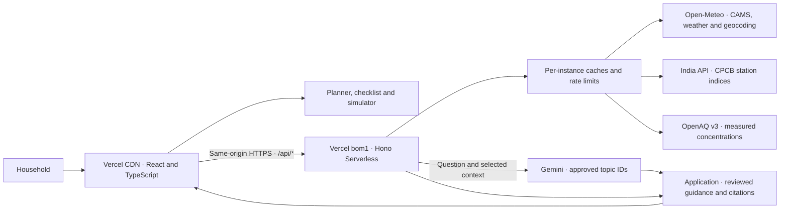

# SaansAI — Urban Air Quality Assistant

SaansAI helps Indian households decide what to do on polluted days. Start with [today’s action plan](https://aqi-tau.vercel.app/), select a city and try a sample household. No account or API key is required to use the public application.

## PromptWars Challenge 06 · Urban Air Quality Assistant

The chosen vertical is **Urban Air Quality Assistant**. The planner uses the selected Indian city, household sensitivity, schedule and commute to build a daily checklist and find lower-exposure windows. The app pauses forecast-based suggestions when the modeling data is stale or missing or a fresh India AQI report raises a caution. Gemini selects reviewed topics for contextual questions, and the app renders the cited guidance. The same guidance remains available through rules mode when Gemini is unavailable.

- **Today and Daily planner** combine modeled US AQI and weather with separately labeled station reports. Set work hours, commute, family needs, activity and budget to get cautious time windows and a daily checklist.
- **Indoor air** explains source control, ventilation, filtration and low-emission routines across three budget tiers.
- **Impact simulator** compares petrol use, fuel and fare spending, hypothetical household participation and outdoor PM2.5 concentration-time using documented formulas.
- **Ask SaansAI** uses Gemini to choose up to two reviewed guidance topics from a question and current context. The application calculates numbers, applies safety rules and renders cited answers. Rules mode remains available when Gemini is unavailable.

## Architecture



The server validates requests with Zod, caps JSON bodies at 4 KiB, and sets a restrictive content policy. Upstream responses are size-limited and requests use bounded timeouts. API keys stay in Vercel Environment Variables (encrypted secrets) or the ignored local `.env` file. Household settings and the checklist are stored in the browser. Read [the API contract](docs/api.md) and [data and privacy methodology](docs/methodology.md).

Each secondary view loads independently. `src/client/use-air-readings.ts` owns the request lifecycle and isolates readings by location. The planner and simulator rules live in `src/shared`, and the simulator uses the same field limits for validation and browser input guidance.

### Assumptions

- CAMS supplies regional modeled US AQI. Nearby OpenAQ measurements and CPCB India AQI reports describe separate station observations with their own timestamps and units.
- Household recommendations use the user’s selections and available feeds. The app has no indoor sensor or street-level exposure model.
- The impact simulator compares petrol tailpipe CO₂ and travel spending under editable assumptions. Its outdoor PM2.5 estimate uses one hourly concentration and time outdoors. See the [methodology and limitations](docs/methodology.md).

## Getting Started

### Prerequisites
- Node.js `>=22.14`

### Local Development
1. Copy the environment template if you want to enable optional OpenAQ or Gemini API integrations:
   ```bash
   cp .env.example .env
   ```
2. Install dependencies and start the development server:
   ```bash
   npm ci
   npm run dev
   ```
   Open `http://127.0.0.1:4173`. Without keys, the app uses Open-Meteo and the CPCB station relay. The assistant labels its deterministic rules responses.

### Environment Variables
See [.env.example](.env.example):
- `PORT` (default `4173`)
- `OPENAQ_API_KEY` (optional, server-only)
- `GEMINI_API_KEY` (optional, server-only)
- `GEMINI_MODEL` (optional, defaults to [`gemini-3.5-flash-lite`](https://aistudio.google.com/docs/models/gemini-3.5-flash-lite))
- `GEMINI_DAILY_LIMIT` (optional, defaults to 100 attempted classifications per process in a 24-hour window)
- `SAANS_PUBLIC_ORIGIN` (optional, exact HTTPS origin only needed for cross-origin API access; omit for same-origin Vercel)

## Verification

```bash
npm run check      # TypeScript strict typecheck
npm run build      # Vite client + Node server (dist/server.mjs) + Worker bundle (dist/worker.mjs)
npm run test:coverage # Unit and API tests with coverage thresholds for critical modules
npx playwright install chromium
npm run test:e2e   # Desktop/mobile Chromium journeys and axe A/AA checks
node scripts/smoke.mjs  # Live-provider smoke against a running local production build
```

Local browser tests use the built client and a Hono server with controlled provider data. They cover city changes during requests, stale readings and retry, household persistence, simulator validation and assistant cancellation. Accessibility automation covers the five views, the location dialog and the expanded forecast table. See [verified results and test scope](docs/evaluation.md#challenge-06-quality-pass).

## Deployment

The live same-origin production deployment is on [Vercel (`aqi-tau.vercel.app`)](https://aqi-tau.vercel.app/) in the Mumbai (`bom1`) region (free Hobby plan with Fluid Compute). [vercel.json](vercel.json) and [api/index.ts](api/index.ts) deploy the Vite client (`dist/client`) and Hono API (`/api/*`) on the same HTTPS origin.

1. Run `npx vercel link` and set server-only environment variables (`OPENAQ_API_KEY`, `GEMINI_API_KEY`, `GEMINI_MODEL`, `GEMINI_DAILY_LIMIT`) in Vercel Project Settings. Do not expose keys with `VITE_*`.
2. Automated CI-gated deployments run via [the Vercel workflow](.github/workflows/vercel.yml) (`SAANS_VERCEL_DEPLOY=true` with `VERCEL_TOKEN`, `VERCEL_ORG_ID`, `VERCEL_PROJECT_ID`). Roll back immediately via Vercel Dashboard (**Instant Rollback**) or `npx vercel rollback`.
3. Verify the live instance with `node scripts/smoke.mjs https://aqi-tau.vercel.app` and `SAANS_TEST_URL=https://aqi-tau.vercel.app npm run test:e2e`.

The previous Node server (`npm start` / Docker) and Cloudflare Worker (`dist/worker.mjs`) build targets remain supported.

## Documentation & PromptWars Artifacts

- [Requirements & Verification Matrix](docs/requirements.md)
- [Development Journal](docs/journal.md)
- [AI Tooling & Prompt Evolution](docs/ai-tooling-and-prompts.md)
- [Antigravity Session Artifacts](docs/artifacts/)

- [Data methodology and limitations](docs/methodology.md)
- [Evidence-based evaluation report](docs/evaluation.md)
- [Screen-recording plan](docs/demo.md)
- [LinkedIn draft](docs/linkedin-draft.md)
